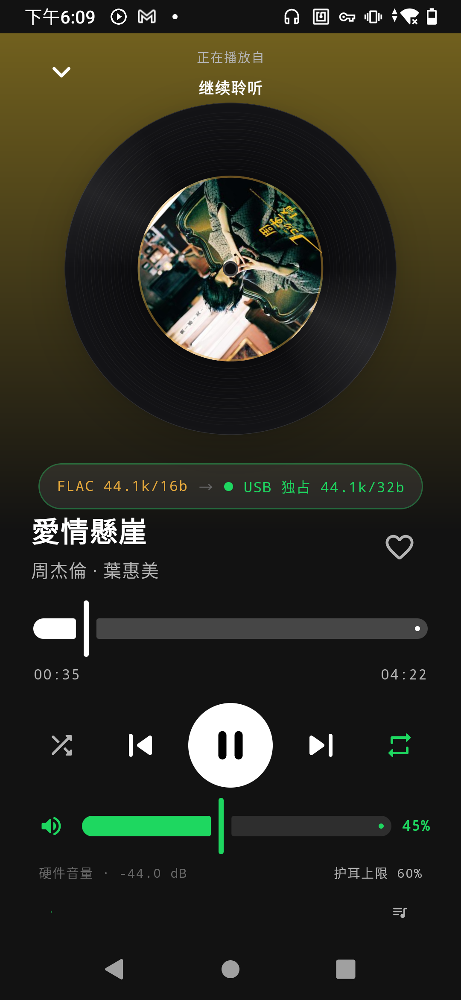
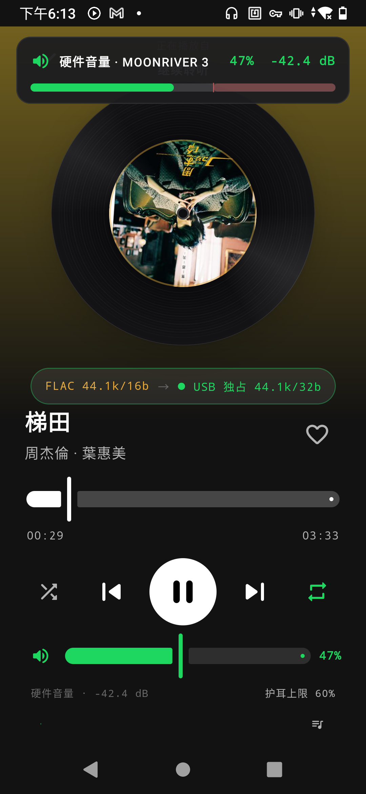
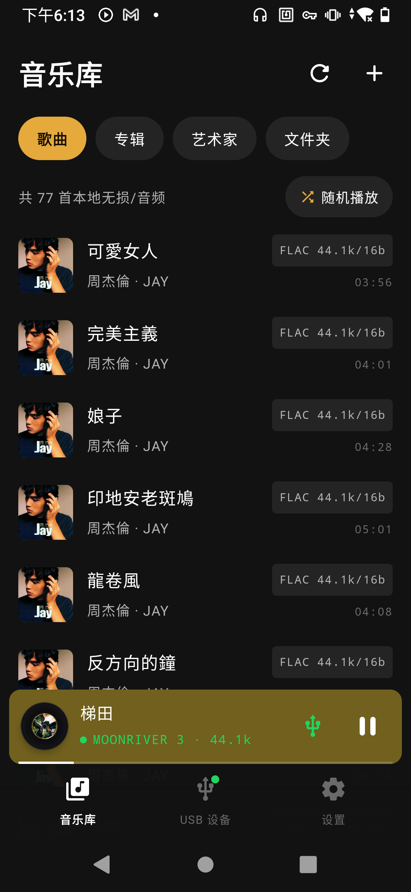
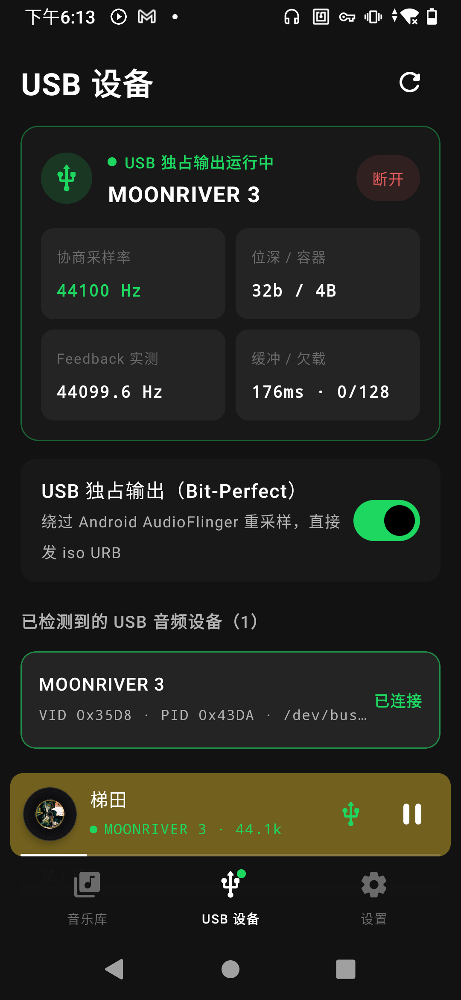
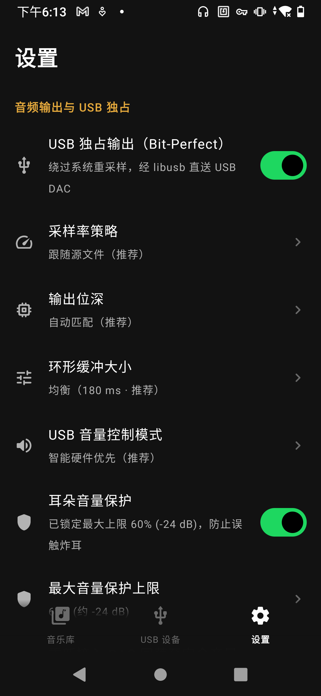
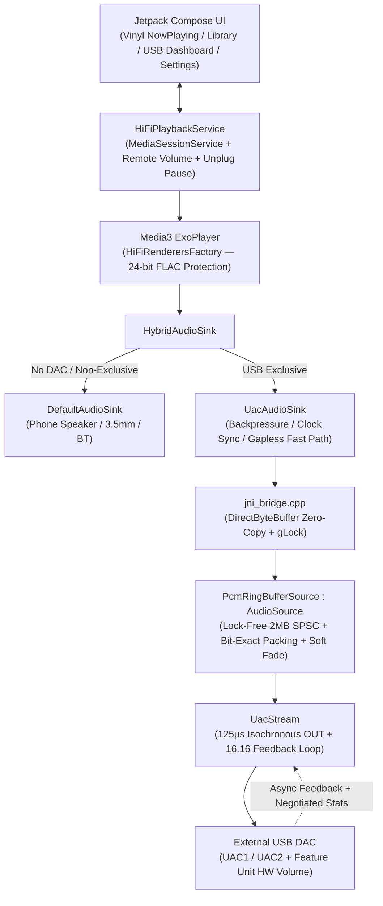

<div align="center">

# Sonify

**Bit-Perfect USB Audio Class (UAC1/UAC2) Exclusive HiFi Player for Android**

[-3DDC84?logo=android&logoColor=white)](https://developer.android.com)
[]()
[]()
[](LICENSE)

**English** | [简体中文](README_ZH.md)

</div>

---

**Sonify** is an open-source, local-first Android HiFi audio player featuring a custom **userspace USB Audio Class (UAC1/UAC2) driver** built on `libusb`. By bypassing Android's `AudioFlinger` resampling pipeline entirely, Sonify delivers true **bit-perfect PCM audio (up to 384 kHz / 32-bit)** directly to external USB DACs—paired with a minimalist **Spotify-inspired dark vinyl UI** and hardware-backed **hearing protection**.

## Screenshots

<p align="center">
  
  
  
  
  
</p>

| View | Highlights |
|---|---|
| **Now Playing (Vinyl)** | Spinning canvas vinyl disc with fixed specular sheen, dynamic album-art ambient gradient, live **Source → Negotiated Output** signal badge, and embedded hardware volume bar |
| **Volume HUD & Ear Guard** | Physical volume buttons hijacked in USB exclusive mode, showing live dB attenuation and a red hearing-protection ceiling zone |
| **Music Library** | Instant lossless header scanner (FLAC/WAV/MP3/M4A/OGG/OPUS), album cover grid, folder & artist drill-down, resume-last-session card |
| **USB DAC Dashboard** | Real-time negotiated sample rate, bit depth, async feedback clock rate (`fbRate`), buffer depth, underrun counter, and built-in 440Hz/1kHz test tone diagnostics |
| **Settings** | Minimalist dark grouped preferences for USB output policy, hearing protection ceiling, gapless playback, dark canvas & accent themes |

---

## Key Features

### 1. True Bit-Perfect USB Exclusive Engine (C++17 + libusb)
- **Bypasses Android `AudioFlinger`**: Uses Android `UsbManager` permission + `claimInterface(force = true)` to detach the kernel `snd-usb-audio` driver, duplicates the `usbdevfs` file descriptor (`dup(fd)`), and wraps it via `libusb_wrap_sys_device()`.
- **Full UAC1 & UAC2 Control**: Parses Audio Control & Streaming descriptors, auto-detects non-standard `wIndex` byte orders at runtime, negotiates native clock rates (`GET_RANGE` / `SET_CUR`), and streams microframe-accurate (`125 µs` high-speed) isochronous OUT URBs.
- **Closed-Loop Async Feedback**: Reads the DAC's 16.16 fixed-point feedback endpoint and smoothly locks host packet pacing to the DAC's actual crystal oscillator (verified within `< 10 ppm` on Moondrop MOONRIVER 3, zero underruns).
- **24-bit / 32-bit Lossless Pipeline**: Custom Media3 `AudioSink` (`UacAudioSink`) + `HiFiRenderersFactory` prevents Android MediaCodec from silently truncating 24-bit FLAC to 16-bit, feeding a lock-free SPSC C++ ring buffer (`PcmRingBufferSource`) with pure integer bit-shifting when running at unity gain.
- **Seamless Local Fallback**: Automatically falls back to standard `DefaultAudioSink` when no USB DAC is connected or when USB exclusive mode is disabled.

### 2. Hardware Volume & Hearing Protection
- **UAC1/UAC2 Feature Unit Hardware Volume**: Automatically discovers playback Feature Units (supporting both Master and independent L/R channels) and adjusts the DAC's internal hardware attenuator via `SET_CUR`, keeping the digital PCM stream **100% bit-perfect**. Falls back seamlessly to a logarithmic dB (`-60 dB .. 0 dB`) 32-bit float software attenuator on DACs without a Feature Unit.
- **Physical Volume Key Hijacking**: Intercepts hardware volume `+/-` keys in the foreground (`dispatchKeyEvent`) and background/screen-off (`MediaSession` remote volume forwarding) during USB exclusive playback, leaving system media volume untouched.
- **4-Layer Ear Protection**:
  1. Configurable hard maximum volume ceiling (default **60% / -24 dB**), enforced in UI, key handling, and C++ native layer.
  2. Safe startup attenuation before the very first isochronous packet is sent (default **25% / -45 dB**).
  3. Automatic safe-volume reset on DAC re-plugging + per-DAC (`vid:pid`) volume memory.
  4. Explicit red safety confirmation dialog before raising the ceiling above 80%, disabling protection, or enabling 0 dBFS Fixed Direct Pass-Through.

### 3. Player & Library Experience
- **Gapless Playback**: Reuses the active USB isochronous stream without tearing down alt settings or clocks between same-sample-rate tracks.
- **Click-Free Transitions**: 5 ms smooth fade-in / fade-out on pause, resume, seek, and sample-rate switching.
- **Ultra-Fast Lossless Metadata Scanner**: Custom binary header parser for FLAC (`STREAMINFO`, `VORBIS_COMMENT`, embedded `PICTURE`) and WAV (`fmt`, `data`, `LIST/INFO`) with local folder cover fallback and incremental fingerprinting via Room.
- **Background Playback Reliability**: `MediaSessionService` foreground service, Spotify-style 5-button notification (`♡ Favorite · ⏮ · ⏯ · ⏭ · 🔁 Repeat`) with live HiFi output spec subtitle and in-process `512×512` artwork loader, dedicated **Vinyl Lockscreen** (`LockScreenActivity` via `USE_FULL_SCREEN_INTENT`), `nice = -16` audio-priority USB event loop for glitch-free screen-off playback, headphone/USB unplug auto-pause, headset button resumption (`onPlaybackResumption`), and smart `WakeLock`.
- **System Audio Focus & Non-Destructive Ducking**: Full Android `AudioFocus` preemption, automatic pause/resume around phone calls and voice prompts, and `-12 dB` USB hardware/software ducking with 3 configurable policies (`Standard Duck`, `Pause on Duck`, `Ignore Duck`).
- **Immersive Music Mode & Zen Vinyl**: True Edge-to-Edge layout with independent status bar and navigation bar hiding (`Now Playing & Lockscreen` or `Global` scope), optional desktop-stand keep-screen-on, and one-tap **Zen Vinyl** mode (tap the spinning disc to hide all chrome, leaving only the enlarged vinyl, live signal badge, track title, and a 2dp bottom progress bar).
- **Subsonic / OpenSubsonic Media Server Support**: Multi-account login & switching for self-hosted servers (**Navidrome, Subsonic, Airsonic-Advanced, Gonic, LMS, Ampache, Jellyfin Subsonic plugin**), passwords encrypted at rest via **Android Keystore (AES-256-GCM)**, salted MD5 token auth (+ optional legacy `p=enc:` & per-server self-signed TLS trust), on-demand browsing (Newest/All Albums, Artists, Playlists, Starred, Random Mix, multi-folder filter, live `search3`), bidirectional favorite sync, optional scrobbling, and **Bit-Perfect `format=raw` streaming** directly through the USB DAC engine (with optional cellular transcoding).
- **Playlists, Batch Operations, Multi-Sort & Offline Lossless Downloads**: Full playlist lifecycle for both local playlists (mixing local + Subsonic tracks) and remote Subsonic server playlists (`createPlaylist` / `updatePlaylist` / `deletePlaylist`), Spotify-style **2×2 collage & custom gallery covers**, multi-select batch add/remove/download, persistent sorting by **Title, Album, Artist, Recently Added, or Custom order**, sequential & shuffle playback, and offline original-file downloads (`download.view`) to `/sdcard/Music/SonifyDownloads` (or app-private storage) with zero-data offline-first Bit-Perfect USB playback.
- **WiFi LAN Music Transfer (Responsive Mobile & PC Web UI)**: Built-in zero-bloat streaming HTTP server with foreground service keep-alive, QR code pairing, optional 4-digit PIN lock, Spotify-Dark Web UI dynamically synced with the App's theme (desktop two-column drag-and-drop supporting whole album folders + mobile touch-first tabbed layout), **3-layer duplicate prevention** (fast pure-JS/Kotlin SHA-256 fingerprint pre-check + library check + atomic server verification), persistent upload history synced between App & Web, and instant auto-indexing into the music library.
- **Immersive Synced Lyrics & Multi-Source Engine**: 5-tier fallback waterfall (user override/imported `.lrc` → sidecar `.lrc` with automatic UTF-8/UTF-16/GB18030 decoding, enhanced `<mm:ss.xx>` word timestamps & bilingual merge → embedded FLAC/MP3/M4A tags → Subsonic/OpenSubsonic synced lyrics → free open-source **LRCLIB** auto-match & manual candidate search). Features an edge-to-edge **Fluid Multi-Color Aurora** backdrop (plus Android 10+ compatible **Soft Blurred Cover** and **Minimal Dark**), **60fps Progressive Sweep** lyric highlight (plus **Pure Glow**, **Accent Tint**, and **Frosted Capsule**), distance-based depth-of-field with seamless `DstIn` alpha feathering, rhythmic **3-dot interlude indicators**, 5-second auto-hiding **Zen Lyrics Mode**, a translucent live-preview customizer panel, and a dedicated **Lyrics & Immersive Style** settings section with an animated real-time preview card (4 font families, 16–32sp continuous size, line spacing, alignment, active bold, bilingual translation).
- **Full-Screen Cross-Source Global Search**: Keeps the clean 3-Tab layout while turning the Library search icon into a full-screen unified search hub covering Local Songs, Albums, Artists, Local Playlists, Subsonic Remote (`search3`), and local/cached `.lrc` **search-by-lyrics** (with timestamp jump). Features **Simplified ↔ Traditional Chinese normalization** (e.g., querying `周杰伦 叶惠美` hits `周杰倫 葉惠美`), multi-token relevance ranking, warm-gold match highlighting, audio spec search (`FLAC 96k`), Quick Discovery cards, and persistent search history (last 12 queries).
- **Crash Interception, Isolated `:crash` Auto-Restart & Sanitized Reporting**: Main-process `SonifyCrashHandler` safely closes the USB DAC stream (160 ms non-blocking guard), strips local file paths and Subsonic credentials, saves sanitized JSON reports locally, evaluates a **30s / 3-crash loop breaker**, and launches an isolated `:crash` process (`CrashRecoveryActivity`) with a **3-second auto-restart countdown** (pausable to inspect/copy/upload stack traces, plus safe-mode cache reset if a crash loop is detected).
- **In-App Updates & Self-Hosted Cloud Distribution**: Automatic 12-hour throttled checks + manual checks in Settings, release notes & force-update support, streaming download with live speed/progress, **mandatory SHA-256 integrity verification**, Android 7–15 `FileProvider` & unknown-sources permission guidance, plus a zero-dependency Python 3 server package (`server/sonify_server.py`, Nginx HTTPS config, `systemd` service) and one-command release script (`scripts/publish_release.sh`).

---

## Architecture



---

## Verified Hardware

| Device / DAC | Interface | Verified Capabilities |
|---|---|---|
| **Moondrop MOONRIVER 3** (`VID 0x35D8 / PID 0x43DA`) | UAC2 High-Speed | 44.1k–768kHz clock negotiation (`wIndex` auto-probed `0x0102`), 32-bit/4B iso OUT (`125 µs` microframe), async feedback locked at `44099.6 Hz` (0 underruns), Feature Unit `ID=10` L/R hardware volume (`-100..0 dB`, `0.5 dB` step) |

---

## Build & Development

### Requirements
- **Android Studio** / Gradle 8.14+
- **JDK 17**
- **Android SDK** `compileSdk = 35`, `minSdk = 24`
- **NDK** `28.2.13676358`, **CMake** `3.22.1`
- Target ABI: `arm64-v8a` (`libusb 1.0.27` is compiled statically from `third_party/libusb/`)

### Build Commands

```bash
export ANDROID_HOME=$HOME/Library/Android/sdk

# Run unit tests & build debug APK
./gradlew :app:testDebugUnitTest :app:assembleDebug

# Important: When modifying C++ native files, clear native caches to prevent stale .so packaging
rm -rf app/build app/.cxx build
./gradlew :app:assembleDebug --no-daemon --no-build-cache
```

APK output: `app/build/outputs/apk/debug/app-debug.apk`

### Quality Assurance & Real-Device Release Gate
Every feature and modification must pass unit tests **and** real-device verification before release:
- Mandatory Gate Rule: [AGENTS.md](AGENTS.md) & [Release Gate SOP](docs/testing/RELEASE_GATE.md)
- Master Test Plan: [docs/testing/TEST_PLAN.md](docs/testing/TEST_PLAN.md)
- End-to-End Test Cases (70 cases): [docs/testing/TEST_CASES.md](docs/testing/TEST_CASES.md)
- Device QA Reports: [docs/testing/reports/](docs/testing/reports/)

### Debugging USB Audio Logs

```bash
adb logcat -s HiFiAudio:* HiFiVolume:* HiFiAudioSink:* HiFiCodecRenderer:*
```

---

## Roadmap

- [x] **M1**: Custom UAC1/UAC2 native driver, `libusb_wrap_sys_device`, clock negotiation, 125 µs iso OUT, async feedback
- [x] **M2**: Media3 integration, lock-free SPSC PCM ring buffer, closed-loop feedback pacing, lossless scanner + Room DB, Spotify-dark vinyl UI, UAC hardware volume & hearing protection
- [ ] **M3**: 10-band Parametric EQ (C++ biquad DSP + frequency response curve UI), synchronized LRC & floating lyrics, WiFi file transfer, playlists & FTS4 search
- [ ] **M4**: Extended theme presets, battery optimization guides, multi-DAC quirk presets

*(Non-goals by design: commercial subscription streaming platforms, DSD, proprietary closed-source audio effects.)*

---

## License

Licensed under the [Apache License 2.0](LICENSE).
`third_party/libusb/` is included under its original **LGPL-2.1** license.
