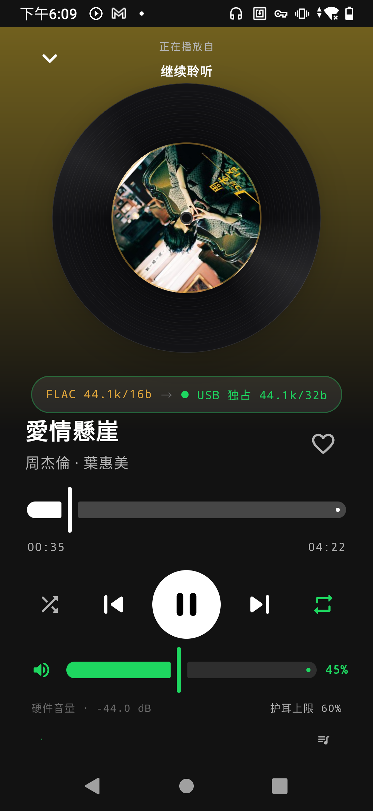
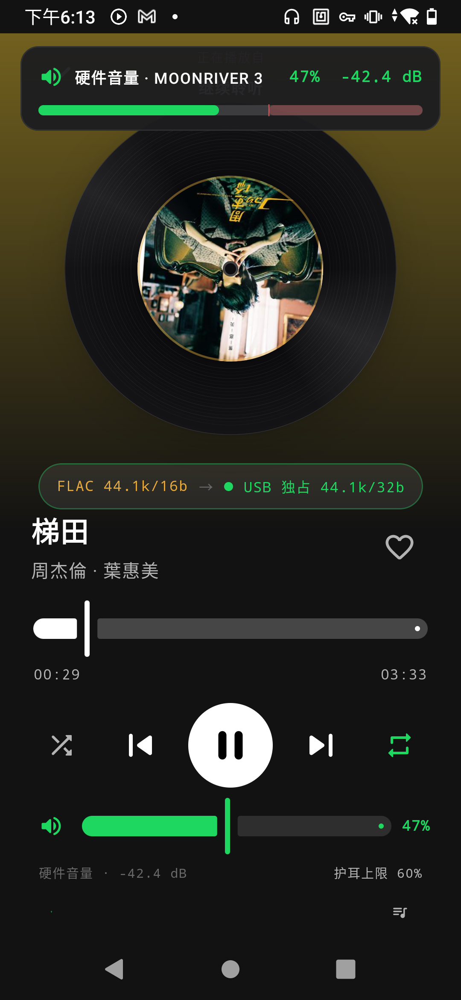
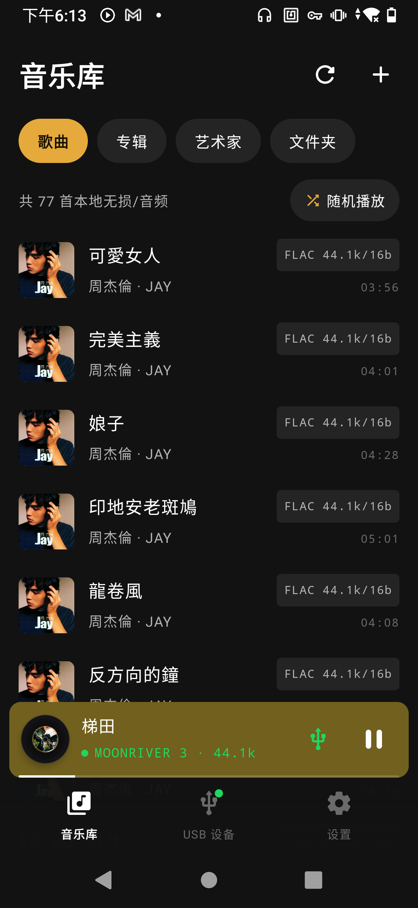
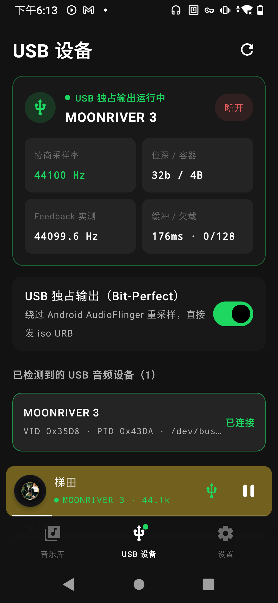
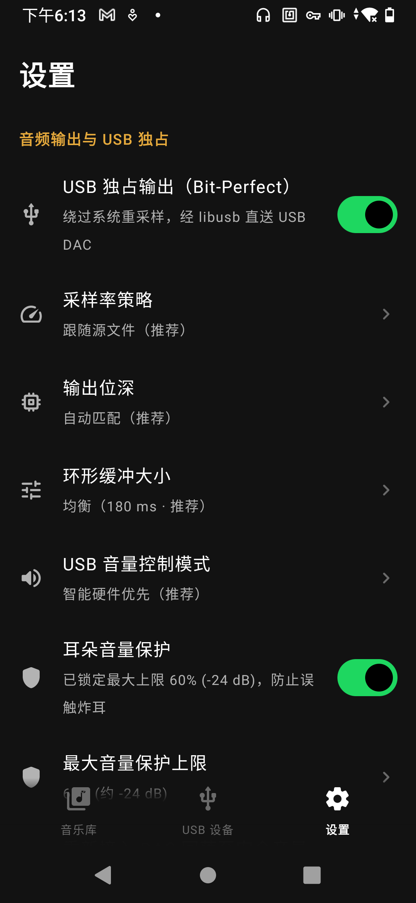
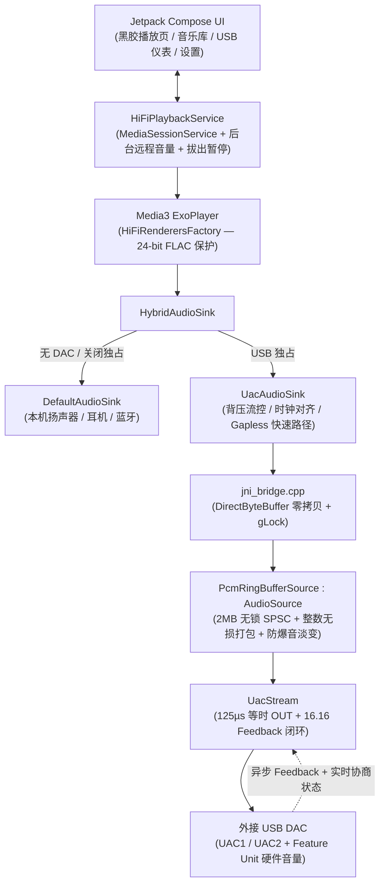

<div align="center">

# Sonify

**开源 Android Bit-Perfect USB 独占（UAC1/UAC2）HiFi 音乐播放器**

[-3DDC84?logo=android&logoColor=white)](https://developer.android.com)
[]()
[]()
[](LICENSE)

[English](README.md) | **简体中文**

</div>

---

**Sonify** 是一款专注于本地无损听音体验的开源 Android HiFi 播放器。内置基于 `libusb` 自研的用户态 **USB Audio Class（UAC1/UAC2）独占驱动**，彻底绕过 Android `AudioFlinger` 强制重采样，将 **PCM 最高 384 kHz / 32-bit** 无损音频以真正的 **Bit-Perfect** 方式直送外接 USB DAC；搭配 **Spotify 极简深色 × 旋转黑胶唱片** 视觉设计与硬件级 **耳朵安全音量保护**。

## 界面预览

<p align="center">
  
  
  
  
  
</p>

| 页面 | 核心特性 |
|---|---|
| **黑胶全屏播放页** | 纯 Canvas 绘制旋转黑胶唱片与静止 45° 高光、封面主色暗调氛围渐变、实时 **源格式 → 实际协商输出** 双徽章胶囊、常驻硬件音量控制条 |
| **护耳悬浮音量 HUD** | USB 独占模式下接管手机物理音量键，实时显示百分比、衰减 dB 以及右侧红色护耳上限锁定区 |
| **本地无损音乐库** | 毫秒级无损头解析（FLAC/WAV/MP3/M4A/OGG/OPUS）、专辑封面网格、艺术家/文件夹钻取、首页「继续上次播放」断点卡片 |
| **USB 设备与诊断页** | 实时展示实际协商采样率、位深、异步 Feedback 实测晶振频率（`fbRate`）、缓冲水位与欠载计数，内置可折叠 440Hz/1kHz 工程测试音工具 |
| **设置页** | Spotify 风格极简深色分组设置，覆盖 USB 独占策略、耳朵安全保护上限、无缝播放、黑胶/方形封面与深色主题切换 |

---

## 核心功能

### 1. 自研 Bit-Perfect USB 独占音频引擎（C++17 + libusb）
- **绕过 Android `AudioFlinger`**：通过 `UsbManager` 授权 + `claimInterface(force = true)` 剥离内核 `snd-usb-audio` 驱动，`dup(fd)` 后交由 `libusb_wrap_sys_device()` 在应用进程内直接发送等时传输（Isochronous OUT）。
- **完整 UAC1 / UAC2 协议支持**：自动解析 Audio Control 与 Audio Streaming 描述符、运行时自动探测非标准 `wIndex` 字节序、查询采样率表（`GET_RANGE`）并动态切换 DAC 时钟（`SET_CUR`），按 High-Speed `125 µs` microframe 精准排包。
- **异步 Feedback 闭环调速**：持续读取 DAC 16.16 定点反馈端点并平滑微调发包速率，实测在 水月雨 MOONRIVER 3 上精准锁定 `44099.6 Hz`（与晶振偏差 < 10 ppm，零欠载）。
- **24-bit / 32-bit 无损通路**：自定义 Media3 `UacAudioSink` 与 `HiFiRenderersFactory` 显式保护 24-bit FLAC 不被系统解码器静默截断为 16-bit，经零拷贝 `DirectByteBuffer` 送入 2MB 无锁 SPSC 环形缓冲（`PcmRingBufferSource`），直通时走纯整数位深移位路径。
- **无 DAC 优雅回退**：未连接 USB DAC 或关闭独占时自动回退至 `DefaultAudioSink` 本机扬声器/耳机输出。

### 2. UAC 硬件音量与四重耳朵安全保护
- **UAC1/UAC2 Feature Unit 硬件音量优先**：自动解析播放通路 Feature Unit（支持 Master 及独立左右声道），直接调节 DAC 内部硬件衰减器，**数字 PCM 保持 100% Bit-Perfect 直通**；无硬件音量能力的 DAC 自动无缝切换为 C++ 对数 dB（`-60 dB .. 0 dB`）32-bit 浮点软件衰减。
- **全场景物理音量键接管**：USB 独占时前台（`dispatchKeyEvent`）与后台/息屏（`MediaSession` 远程音量代理）全面接管手机侧边物理音量 `+/-` 键，不干扰系统媒体音量；切回本机输出自动还原原生系统音量。
- **四重防炸耳护耳机制**：
  1. 可自定义最大音量硬上限（默认开启 **`60%` / -24 dB**），UI、物理按键与 C++ Native 底层三重硬钳位。
  2. 连接 DAC 后、发送第一个音频包前强制压低至安全起步音量（默认 **`25%` / -45 dB**）。
  3. 按 DAC `vid:pid` 独立记忆音量，且支持重新插拔自动回落至安全起步音量。
  4. 调高上限超过 80%、关闭护耳保护或切换「固定直通 100%（0 dBFS）」时强制弹出红色高音量警告二次确认。

### 3. 本地播放与媒体库体验
- **真·无缝播放（Gapless）**：同采样率连续曲目保持 USB 流与时钟不断开直接续流。
- **防爆音淡入淡出**：暂停、恢复、拖动进度与切率时施加 5 ms 平滑淡变。
- **高速无损扫描与 Room 入库**：自研二进制头解析 FLAC（`STREAMINFO`/`VORBIS_COMMENT`/`PICTURE`）与 WAV（`fmt `/`data`/`LIST INFO`），支持内嵌与目录封面匹配、增量扫描去重与 SAF 导入。
- **后台、锁屏与通知栏体验**：`MediaSessionService` 前台服务、Spotify 风格 5 键通知栏（`♡ 收藏 · ⏮ · ⏯ · ⏭ · 🔁 循环`）+ 实时 HiFi 协商规格副标题 + 跨进程 `512×512` 高清封面加载、专属 **黑胶锁屏界面**（基于 `USE_FULL_SCREEN_INTENT` 零悬浮窗权限）、USB 事件线程 `nice = -16` 音频高优先级防息屏爆音、耳机/USB 拔出自动暂停、线控一键断点续播与按需 `WakeLock`。
- **系统音频焦点抢占与无损 Ducking**：完整适配 Android 音频焦点（第三方音视频互斥抢占、来电/导航打断自动暂停与恢复），支持 USB 独占 `-12 dB` 硬件/软件自动降音，并在设置页提供三种策略（标准降音 / 遇提示暂停 / 忽略短提示音）。
- **沉浸音乐模式 & 纯享黑胶（Zen Vinyl）**：全链路 Edge-to-Edge 无黑边延伸，支持分别配置隐藏顶部状态栏与底部导航栏（默认仅在播放页与锁屏页生效，亦支持全局沉浸）、桌面黑胶架常亮开关，以及点击唱片一键切换 **纯享黑胶** 视图（仅留放大旋转黑胶、信号胶囊、曲目名与底部 2dp 进度线，轻触任意处复原）。
- **Subsonic / OpenSubsonic 媒体服务器支持**：支持多服务器账号登录与一键切换（兼容 **Navidrome / Subsonic / Airsonic / Gonic / LMS / Ampache / Jellyfin Subsonic 插件**），账号密码采用 **Android Keystore（AES-256-GCM）** 硬件密钥加密保存，默认随机盐值 MD5 Token 认证（可选旧版 `p=enc:` 兼容与单服务器信任自签名 HTTPS 证书）；支持最新专辑、全部专辑分页、艺术家、歌单、已收藏、随机发现、多目录筛选与 `search3` 实时远程搜索，双向收藏同步与 Scrobble 上报，默认 Wi-Fi **原盘无损直通（`format=raw`）** 直连 USB DAC 独占引擎，同时支持移动网络按需转码。
- **歌单管理、批量操作、多维排序与离线无损下载**：完整支持本地自建歌单（可混收本地与 Subsonic 曲目）及 Subsonic 服务器歌单读写同步（新建/改名/加歌/批量删歌/删除），支持 **Spotify 2×2 专辑四宫格自动封面** 与相册自定义高清封面、多选批量加入歌单/移出歌单/批量下载、按 **标题 / 专辑 / 艺人 / 最近添加 / 自定义顺序** 升/降序持久化排序、歌单顺序与随机播放，以及单曲/整张歌单/整张专辑离线原盘下载（默认归档至 `/sdcard/Music/SonifyDownloads`，播放已下载远程曲目自动零流量直通 USB DAC）。
- **WiFi 局域网传歌（手机 + PC 双端自适应 Web）**：内置轻量零 OOM 流式 HTTP 服务与前台保活通知、高清扫码二维码与可选 4 位临时 PIN 访问码；Web 页面严格统一 App 的 Spotify Dark 视觉并动态同步深色底色与强调色（PC 端双栏支持拖拽整张专辑文件夹，手机端单栏触控分段 Tab）；支持 **三层防重复上传**（纯 JS/Kotlin 一致分段 SHA-256 预检 + 本地库比对 + 服务端原子校验）、App/Web 双向持久化上传历史，传完自动无损解析秒入音乐库。
- **沉浸式同步歌词、多色流光背景与多源匹配引擎**：五级瀑布源自动解析（用户自选/导入缓存 → 同目录 `.lrc` 多编码防乱码、增强型 `<mm:ss.xx>` 逐字时间戳解析与双语合并 → FLAC/MP3/M4A 内嵌标签 → Subsonic/OpenSubsonic 同步歌词 → 开源免费 **LRCLIB** 自动匹配与手动搜词选候选）；全屏歌词采用边到边 **流体多色氛围光晕**（兼容全机型 60fps，另可选 **封面暗调虚化底图** 与 **极简深黑**）、60fps **逐句流光扫色高亮**（另可选 **柔光纯白 / 主题强调色 / 暗调玻璃聚焦条**）、距离景深衰减 + `DstIn` 上下真实 Alpha 羽化渐隐、前奏与长间奏 **呼吸三点律动**、5 秒无操作自动隐身 **纯享歌词态**、歌词页底部半透明「所见即所得」实时样式调参面板，以及设置页专属 **「歌词与沉浸样式」** 分组与顶部实时动态预览卡片（4 种字体风格、16–32sp 连续字号滑块、行距、对齐、加粗与译文独立开关）。
- **全屏跨源全局搜索与简繁互通**：保持简洁 3-Tab 架构，点击音乐库顶部放大镜一键直达全屏聚合搜索页，覆盖本地歌曲、专辑、艺人、自建歌单、Subsonic 远程曲库（`search3`）与本地/缓存 `.lrc` **歌词搜歌**（点击歌词片段直达对应时间点播放）；内置 **简繁互通归一化**（搜简体 `周杰伦 叶惠美` 秒中繁体 `周杰倫 葉惠美`）、多词加权相关性排序、音质规格检索（如 `FLAC 96k`）、命中词暖金高亮、快捷发现卡片与持久化搜索历史（最近 12 条）。
- **崩溃拦截、独立 `:crash` 进程自动重启与脱敏日志上报**：主进程 `SonifyCrashHandler` 在崩溃瞬间 160ms 非阻塞安全关闭 USB DAC 流、自动剥离本地私人路径与 Subsonic 凭据、落盘脱敏报告并执行 **30 秒 ≥ 3 次连崩熔断保护**，随即拉起独立 `:crash` 进程恢复页（`CrashRecoveryActivity`）提供 **3 秒倒计时自动冷重启**（可随时暂停查看/复制/手动上报堆栈；触发连崩熔断时自动停用倒计时并提供「清理缓存并重启」安全模式）。
- **应用内安全更新、全链路强制更新与自建云分发**：支持启动 12 小时节流自动检查与设置页手动检查、版本日志与 **全状态强制更新保护**（覆盖 `Available` / `Downloading` / `Verifying` / `ReadyToInstall` / `Error` 全阶段锁定，绕过关闭自动检查与忽略版本记录，屏蔽返回键与遮罩点击并提供「退出应用」）、HTTP/1.1 稳定流式下载与实时速度/进度、**安装前强制 SHA-256 完整性校验**、Android 7–15 `FileProvider` 与返回自动刷新未知来源权限引导；附带零依赖 Python 3 服务端（`server/sonify_server.py` + Caddy/Nginx HTTPS + `systemd`）与一键发版脚本（`scripts/publish_release.sh`）。
- **隐私优先设备日活埋点与运营监控面板（`/admin`）**：客户端仅生成随机 UUIDv4 `installId`（零 IMEI/OAID/文件路径/歌名/搜索词采集），采用本地 JSONL 批量上报队列并在设置页提供透明的一键关闭开关（「匿名日活与功能统计」）；服务端基于 SQLite WAL 提供 `POST /api/v1/telemetry/events` 统计（按 UTC+8 汇总 DAU/WAU/MAU、新增设备、次日/七日留存、版本与 USB DAC 分布），并内置 Spotify Dark 风格认证运营面板（`/admin`，由 `/etc/sonify-server/admin.env` 独立令牌保护），支持日活趋势 SVG 图表、硬件排行、脱敏崩溃日志查看与线上强制更新策略实时切换。
- **多语言国际化（中英双语）与零中断热切换**：完整支持 **跟随系统 / 简体中文 / English**（兼容 Android 13+ 系统应用语言），覆盖全部页面、设置枚举、通知栏、黑胶锁屏、独立 `:crash` 恢复页与 WiFi 传歌 Web 界面；切换语言 1 帧即时生效，不重建 Activity、不断开 USB DAC、不中断无损播放。配套落地标准规范文档与字段对照字典（[多语言规范](docs/i18n/I18N_STANDARD.md) · [字段对照字典](docs/i18n/STRING_KEY_CATALOG.md)），方便后续按标准快速扩展更多语种。

---

## 技术架构



---

## 已验证硬件

| 设备 / DAC | 接口协议 | 实测验证结果 |
|---|---|---|
| **水月雨 MOONRIVER 3** (`VID 0x35D8 / PID 0x43DA`) | UAC2 High-Speed | 支持 44.1k–768kHz 时钟协商（自动探测 `wIndex=0x0102`）、32-bit/4B 等时 OUT（`125 µs` 微帧）、Feedback 闭环稳锁 `44099.6 Hz`（0 欠载）、Feature Unit `ID=10` 左右声道硬件音量（`-100..0 dB`，`0.5 dB` 步进） |

---

## 本地构建指南

### 环境要求
- **Android Studio** / Gradle 8.14+
- **JDK 17**
- **Android SDK**：`compileSdk = 35`、`minSdk = 24`
- **NDK**：`28.2.13676358`、**CMake**：`3.22.1`
- 目标架构：`arm64-v8a`（`third_party/libusb/` 内置 `libusb 1.0.27` 源码，自动静态编入）

### 构建与测试命令

```bash
export ANDROID_HOME=$HOME/Library/Android/sdk

# 运行单元测试并构建 Debug APK
./gradlew :app:testDebugUnitTest :app:assembleDebug

# 提示：修改 C++ 原生代码后，建议彻底清理原生缓存避免旧 .so 残留
rm -rf app/build app/.cxx build
./gradlew :app:assembleDebug --no-daemon --no-build-cache
```

产物路径：`app/build/outputs/apk/debug/app-debug.apk`

### 质量保障与真机测试上线门禁
所有新增功能与代码改动上线前必须先通过单元测试与真机功能/视觉验收：
- 强制门禁规范：[AGENTS.md](AGENTS.md) · [发布门禁清单](docs/testing/RELEASE_GATE.md)
- 测试总方案：[docs/testing/TEST_PLAN.md](docs/testing/TEST_PLAN.md)
- 端到端测试用例库（83 条）：[docs/testing/TEST_CASES.md](docs/testing/TEST_CASES.md)
- 多语言规范与全量字段字典：[docs/i18n/I18N_STANDARD.md](docs/i18n/I18N_STANDARD.md) · [docs/i18n/STRING_KEY_CATALOG.md](docs/i18n/STRING_KEY_CATALOG.md)
- 真机测试验收报告：[docs/testing/reports/](docs/testing/reports/)

### 调试日志

```bash
adb logcat -s HiFiAudio:* HiFiVolume:* HiFiAudioSink:* HiFiCodecRenderer:*
```

---

## 路线图

- [x] **M1**：自研 UAC1/UAC2 驱动、`libusb_wrap_sys_device`、时钟协商、125 µs 等时 OUT 与异步反馈
- [x] **M2**：Media3 接入、无锁 SPSC 环形缓冲、Feedback 闭环调速、无损扫描 + Room 入库、Spotify 深色黑胶 UI、UAC 硬件音量与四重护耳保护
- [ ] **M3**：10 段参数均衡器 PEQ（C++ biquad + 实时幅频曲线）、LRC 歌词与桌面悬浮歌词、WiFi 传歌、播放列表与 FTS4 拼音搜索
- [ ] **M4**：多套深色皮肤预设、电池保活与厂商指引、更多 DAC 兼容微调

*（明确不做范围：商业在线音乐平台订阅服务、DSD 与黑盒私有音效。）*

---

## 开源许可协议（禁止商用）

本项目采用 **[Sonify 非商用开源许可协议 v1.0](LICENSE)** 发布：
- **允许范围**：个人免费使用、学习研究、非商业用途的二次修改与分享，以及向官方仓库提交 Issue / Pull Request。
- **禁止商用**：**严禁未经作者提前书面授权的任何形式商业用途**，包括但不限于收费分发、套壳广告盈利，或将本项目代码/音频引擎集成、预装至商业软件及商业硬件设备出货。
- **商业授权**：如需企业或硬件商业授权，请通过 [GitHub 仓库](https://github.com/AceInAndroid/sonify) 联系作者。
- **第三方组件**：`third_party/libusb/` 仍遵循其原始 **LGPL-2.1** 许可协议（详见 `third_party/libusb/COPYING`）。
- **版本日志**：查看 [CHANGELOG.md](CHANGELOG.md) 或 [GitHub Releases](https://github.com/AceInAndroid/sonify/releases)。
