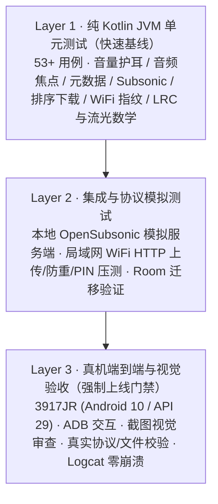

# Sonify 测试总方案（Test Plan）

> 文档版本：v1.0 | 适用版本：Sonify v0.2.0+ | 维护者：Sonify Engineering

---

## 1. 测试目标与质量底线

确保 **Sonify** 的每一项音频引擎、媒体库、远程流媒体、局域网传输及沉浸式视觉体验，在交付给用户之前均经过 **单元测试 + 真机功能实测 + 真机视觉审查 + 稳定性日志验收** 四重验证，杜绝「编译通过但真机白屏/错位/崩溃/功能不通」的问题。

---

## 2. 三层测试金字塔

---

## 3. 测试环境矩阵

| 维度 | 基线配置 | 备注 |
| :--- | :--- | :--- |
| **真机型号** | `3917JR`（arm64-v8a） | ADB Wi-Fi `192.168.31.233:5555` |
| **系统版本** | Android 10（API 29） | 重点验证低版本无 `RenderEffect` 模糊兼容与权限模型 |
| **音频曲库** | `/sdcard/Music` 77+ 无损音频（FLAC/WAV）+ 同目录 `.lrc` | 覆盖多编码中文 LRC 与高码率封面 |
| **外接 DAC** | 水月雨 MOONRIVER 3（VID `0x35D8` / PID `0x43DA`，UAC2） | USB 独占音频回归用（未插 DAC 时走本机输出路径验证 UI 与非 USB 逻辑） |
| **Subsonic 服务端** | 宿主机临时启动的 OpenSubsonic 兼容测试服务端（或指定真实 Navidrome） | 覆盖鉴权、Keystore 加密、分页浏览、远程歌单读写、流播与离线下载 |
| **WiFi 传歌客户端** | 宿主机 `curl` + 响应式 PC/移动端 HTML 结构与接口校验 | 直连手机 `http://<device-ip>:<port>` 实测 |

---

## 4. 缺陷严重等级定义与阻塞标准

| 等级 | 定义 | 上线处理策略 |
| :---: | :--- | :--- |
| **P0（致命）** | 应用崩溃（Crash）、ANR、OOM、音爆/破音/护耳上限失效、数据丢失或明文泄露密码 | **绝对阻塞上线**，必须当场修复并全链路真机复测 |
| **P1（严重）** | 核心功能不可用（登录失败、歌单无法增删、传歌失败、去重失效、歌词不滚动、封面虚化黑屏）或严重 UI 遮挡无法点击 | **绝对阻塞上线**，必须修复并真机复测通过 |
| **P2（一般）** | 边缘交互瑕疵、轻微文字截断、非致命动画抖动、次要提示文案不准确 | 优先当场修复；若延期需记录到已知问题并经用户确认 |
| **P3（建议）** | 锦上添花的动效微调、额外样式扩展建议 | 记入 Backlog，不阻塞本次上线 |

---

## 5. 标准真机验证手法

1. **交互驱动**：使用 `adb shell uiautomator dump /sdcard/ui.xml` 读取真实控件边界坐标，执行 `adb shell input tap / swipe / text` 模拟真实手指操作，不使用绕过 UI 的后门断言。
2. **视觉审查**：每个核心视图和状态切换后通过 `adb exec-out screencap -p` 抓取实时帧到工作区外临时目录，人工/视觉逐张核对：
   - 是否有元素重叠、裁切、状态栏/刘海遮挡、底部手势条挤压；
   - 深色背景下纯白/强调色文字对比度是否清晰；
   - `FLUID_AURORA` 多色光晕、`COVER_BLUR` 柔化封面、`PROGRESSIVE_SWEEP` 扫色、`Serif/Mono` 字体切换是否肉眼真实可见。
3. **落盘与协议硬核验**：
   - 核查 Room 数据库、DataStore 偏好文件、离线下载目录、歌词缓存目录、WiFi 上传目录；
   - 核查 `subsonic_servers` 表密码字段是否为 AES-256-GCM 密文；
   - 核查 HTTP 状态码与 JSON 响应（`200` / `401` / `duplicate`）。
4. **稳定性监控**：每轮测试前后清空并抓取 `adb logcat -d -s 'AndroidRuntime:E' 'FATAL:E' 'ActivityManager:E'`，要求零未捕获异常、零 ANR。
5. **现场清理**：每轮测试结束后清理临时创建的测试歌单、测试 Subsonic 账号、测试上传音频，还原用户手机曲库与常用设置。

---

## 6. 测试文档目录规范

- `AGENTS.md`：仓库级强制真机门禁规范（每次对话自动加载）
- `docs/testing/TEST_PLAN.md`：本文件（测试总方案）
- `docs/testing/RELEASE_GATE.md`：日常改动与发版门禁 Checklist
- `docs/testing/TEST_CASES.md`：全量模块化测试用例库（随新功能持续追加）
- `docs/testing/reports/YYYY-MM-DD_<version>_device_qa_report.md`：每次真机实测的验收报告归档
